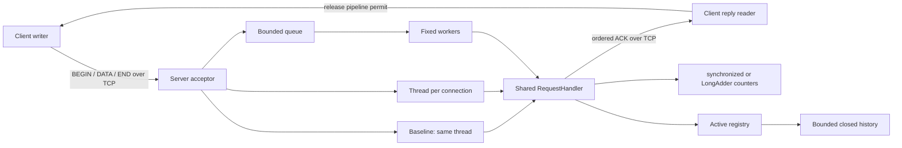

# Following a request through Astra

The acceptor receives a **socket**, not a decoded request. Its scheduling strategy assigns the socket to a handler. The diagram's TCP arrow represents the client's byte stream; parsing takes place only inside the shared handler.

1. `Main` parses CLI options and builds `ServerConfig` or `ClientConfig`.
2. `TcpServer` binds a listening socket. Every accepted connection gets a unique registry entry.
3. A scheduling strategy executes `ConnectionTask`. The pool queues entire connections.
4. `RequestHandler` uses `Protocol.Reader` to read exact frame lengths. It validates order, payload size, and optionally checksum.
5. Valid DATA chunks update connection-local totals and the chosen shared counters. Valid END completes a request and sends ACK.
6. `LoadClient` checks that ACK matches the head of its outstanding-request queue, records latency, and releases a semaphore permit.
7. EOF, errors, timeouts, and shutdown converge on socket closure and exactly-once finalization into history.
8. `BenchmarkRunner` launches separate server/client JVMs, records measurement boundaries, and uses server byte deltas divided by server elapsed time for primary throughput.

## Why there are several different synchronization mechanisms

| Mechanism | Protects |
| --- | --- |
| Shared `synchronized` counter monitor | Atomic counter updates and snapshots in one comparison mode |
| `LongAdder` internal cells | Scalable updates, with approximate running snapshots |
| Entry monitor | Worker start versus expiry, activity checks, and per-connection state |
| Registry lifecycle monitor | Moving active entries into history and taking consistent membership snapshots |
| `ThreadPoolExecutor` queue | Fixed processing/waiting capacity |
| Client semaphore | Maximum outstanding requests on one connection |
| Client concurrent queue | Publishing request metadata from writer to reply reader |

The per-entry monitor is not a global lock: traffic on different connections updates different entries. The registry lifecycle monitor is used for lifecycle changes and inspection, not per-chunk processing. Neither monitor is held during socket I/O.

## Measurement vocabulary

- **Throughput:** payload bytes received per second, excluding protocol overhead.
- **Goodput:** payload bytes belonging to successful acknowledgements per second at the client.
- **Latency:** time from publishing a request immediately before BEGIN until ACK arrives, including local buffering and queueing.
- **Pipeline depth:** requests allowed to remain unacknowledged on one connection.
- **Worker count:** concurrent connection handlers in the fixed pool.
- **Queue depth:** accepted sockets waiting for a handler, not chunks waiting to be read.
- **Ceiling:** the observed upper region of a scaling curve for a specified workload and environment. More workers do not create more CPU, memory bandwidth, or network capacity.
